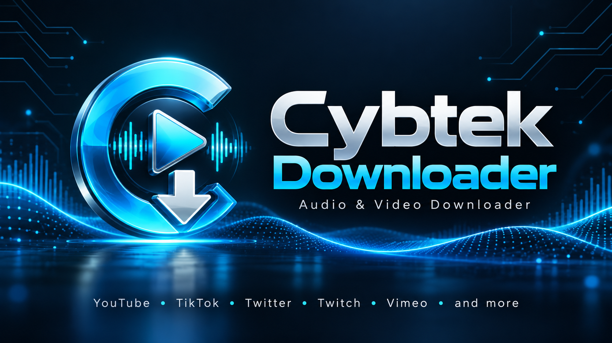

# Cybtek Downloader

**A fast, friendly Windows interface for [yt-dlp](https://github.com/yt-dlp/yt-dlp) and [FFmpeg](https://ffmpeg.org/).**
Copy a link, click a button, and get the video (MP4/MKV) or the audio (MP3, M4A, Opus, OGG, FLAC, WAV) from YouTube, TikTok,
Instagram, Twitter / X, Twitch, Vimeo and [over a thousand other sites](https://github.com/yt-dlp/yt-dlp/blob/master/supportedsites.md).

It is a single PowerShell script. There is nothing to compile and nothing to install. It runs on the PowerShell that already
comes with Windows.

---

## Why I built it

yt-dlp and FFmpeg are two of the best open-source tools there are, but they are command-line programs. To grab one song you
have to open a terminal, remember the right flags (`-x --audio-format mp3 --audio-quality 0 --embed-thumbnail ...`), quote
your paths correctly, and keep both programs updated by hand. Sites change all the time, so an out-of-date yt-dlp is the most
common reason a download fails.

I wanted the power of those tools without the typing:

- **Copy a link in your browser** and it is already in the app.
- **One click** for video, one click for audio.
- **The app looks after yt-dlp and FFmpeg itself**: it installs them, checks for updates when it starts, and updates them on request.
- **Every option I kept looking up** lives in a settings window instead of my notes.

## Features

| | |
|---|---|
| **One-click downloads** | Download Video (MP4 or MKV) and Download Audio (MP3, M4A, Opus, OGG, FLAC or WAV) buttons, with a live progress bar, speed and time left |
| **Clipboard auto-paste** | Copy a link from the selected source and it appears in the URL box |
| **Sources** | YouTube (the default), TikTok, Instagram, Twitter / X, Twitch, Facebook, Reddit, Vimeo, Dailymotion, Bilibili, SoundCloud, Bandcamp, or any other site yt-dlp supports |
| **Dependency manager** | Checks at start-up that yt-dlp and FFmpeg are installed and up to date, and installs or updates them from GitHub. Can also archive the current versions so you can roll back |
| **Chapters** | Save each chapter of a video as its own file (great for albums and mixes) |
| **SponsorBlock** | Cut sponsor segments, self-promotion and non-music parts out of YouTube videos |
| **Quality control** | Maximum resolution and frame rate, MP3 bitrate or VBR quality, H.264 preference for older devices |
| **Extras** | Embed thumbnails, metadata, chapter markers and subtitles; download playlists; keep a download history; speed limit; proxy; browser cookies for sites that need a login |
| **Addons** | Extend the app with your own PowerShell scripts (see [Writing an addon](#writing-an-addon)) |
| **Activity window** | Shows every line yt-dlp prints, plus the exact command it ran. Also written to daily log files |
| **Help documents** | Built-in help page (Help > Help Documents, or F1) |

## Getting started

### Requirements

- Windows 10 or 11
- Windows PowerShell 5.1 (built in) or PowerShell 7+
- An internet connection the first time, to download yt-dlp and FFmpeg (the app offers to do this for you)
- Optional, but recommended for YouTube: [Deno](https://deno.com/) (`winget install DenoLand.Deno`). yt-dlp now uses a JavaScript runtime for YouTube.

### Run it

1. Download or clone this repository.
2. Double-click **`Cybtek Downloader.cmd`**.
   Or, from a terminal:
   ```powershell
   powershell -NoProfile -ExecutionPolicy Bypass -File .\CybtekDownloader.ps1
   ```
3. When it asks to install yt-dlp and FFmpeg, click **Yes**.
4. Copy a link, then click **Download Video** or **Download Audio**.

> If Windows blocks the script because it was downloaded from the internet, right-click it, open **Properties**, and tick
> **Unblock**, or run `Unblock-File .\CybtekDownloader.ps1`.

### Repository contents

| File | What it is |
|---|---|
| `CybtekDownloader.ps1` | The whole app |
| `Cybtek Downloader.cmd` | Double-click launcher (starts the app without a console window) |
| `CybtekDownloader-splash.jpg` | Splash screen, help-page banner and the source of the window icon. Keep it next to the script |
| `Addons/NotifyWhenDone.ps1` | A sample addon that shows a Windows notification when a download finishes |
| `addon.txt` | A ready-made prompt to paste into an AI chat to have it write an addon for you |

### Where things are stored

| | |
|---|---|
| Settings | `%APPDATA%\CybtekDownloader\settings.json` |
| yt-dlp and FFmpeg | `%APPDATA%\CybtekDownloader\bin` |
| Addons | `%APPDATA%\CybtekDownloader\addons` |
| Logs | `%APPDATA%\CybtekDownloader\logs` |
| Dependency backups | `%APPDATA%\CybtekDownloader\archive` |
| Downloads | `Videos\Cybtek Downloader` and `Music\Cybtek Downloader` (change them in Settings) |

---

## How it works

The app is a WinForms window written in PowerShell. It doesn't download anything itself: it builds the right yt-dlp command
line from your settings, runs it, and turns yt-dlp's output into a progress bar.

```
 You copy a link ──► clipboard watcher ──► URL box
                                              │
 Settings (JSON) ──► Get-DownloadArguments ───┤
                                              ▼
                     yt-dlp.exe  ──(uses)──►  ffmpeg.exe
                         │  stdout/stderr
                         ▼
        background reader (C#) ──► queue ──► UI timer ──► progress bar, status, Activity window, log file
```

How it was put together:

- **Pure PowerShell + WinForms.** Windows already has everything needed, so the app is one `.ps1` file with no installer.
  It relaunches itself in STA mode when needed, because WinForms and the clipboard require it.
- **A non-blocking UI.** yt-dlp runs as a child process. A small C# class (compiled at start-up with `Add-Type`) reads its
  output on background threads into a thread-safe queue, and a WinForms timer drains that queue on the UI thread.
  PowerShell script blocks are never called from a background thread, which is the usual cause of PowerShell GUIs freezing or crashing.
- **Progress parsing.** yt-dlp runs with `--newline`, so every progress update is its own line. A regular expression picks
  out the percentage, size, speed and time left. Lines such as `[Merger]`, `[ExtractAudio]` and `[SplitChapters]` switch the bar to "working" mode.
- **Smart format selection.** Video uses `-f "bv*+ba/b"` with yt-dlp's format sorting (`-S res:1080,fps:30,vcodec:h264,ext:mp4:m4a`)
  rather than hard filters. You get the best match under your limits, or the closest available when a site has nothing smaller.
- **Dependency management.** Versions are read from `yt-dlp --version` and `ffmpeg -version`, and the latest releases come
  from the GitHub API (`yt-dlp/yt-dlp` and `yt-dlp/FFmpeg-Builds`). FFmpeg comes as daily builds, so it counts as out of date
  once it is more than 30 days older than the newest build. Updates download with a progress bar, and the current versions can be zipped first.
- **Custom theme.** A small C# menu renderer and a custom progress bar give the dark navy and electric-blue look. Windows' DWM API is used for the dark title bar.
- **Addons.** At start-up the app runs each `.ps1` in the addons folder and keeps the hashtable it returns. The app then calls that hashtable's script blocks at set points.

---

## Writing an addon

An addon is a PowerShell script that adds behaviour to the app. You can install one from **Addons > Install Addon...**. It is
copied into `%APPDATA%\CybtekDownloader\addons` and loaded every time the app starts.

> **Want an AI to write one for you?** Open [`addon.txt`](addon.txt), copy all of it into an AI chat, and describe the addon
> you want at the bottom. The rest of this section is for writing one yourself.

### What you need to know

- **PowerShell basics:** script blocks (`{ ... }`), hashtables (`@{ }`), `param(...)`.
- **A little WinForms** if you want to show windows or notifications. `System.Windows.Forms` and `System.Drawing` are already loaded.
- **The yt-dlp command-line options** if your addon changes how downloads run. See the [yt-dlp README](https://github.com/yt-dlp/yt-dlp#usage-and-options).

### The addon contract

An addon file must **return a hashtable** as its last output. Every key is optional except `Name`:

```powershell
@{
    Name        = 'My Addon'                 # shown on the Addons menu
    Version     = '1.0'                      # shown next to the name
    Author      = 'Your name'
    Description = 'One sentence on what it does.'   # tooltip on the Addons menu

    OnLoad             = { param($App)  }    # once, when the app starts or the addon is installed
    OnDownloadStarting = { param($Info) }    # before each download; return a string to add yt-dlp arguments
    OnDownloadComplete = { param($Info) }    # after each download (successful, failed or cancelled)
    MenuAction         = { param($App)  }    # when the user clicks the addon on the Addons menu
}
```

If there is no `MenuAction`, clicking the addon shows its name, version, author, description and file path.

### What the app passes in

**`$App`** (passed to `OnLoad` and `MenuAction`):

| Member | Type | Use |
|---|---|---|
| `$App.Form` | `System.Windows.Forms.Form` | The main window. Use it as the owner for your own dialogs |
| `$App.Settings` | ordered dictionary | The live settings (`VideoDir`, `AudioDir`, `AudioFormat`, `VideoContainer`, ...). Read them freely; changes take effect at once but are only saved if the user later saves Settings |
| `$App.Log` | script block | Writes a line to the Activity window and the log file: `& $App.Log 'Hello'` |
| `$App.SetStatus` | script block | Sets the status line under the progress bar: `& $App.SetStatus 'Working...'` |

**`$Info`** (passed to `OnDownloadStarting` and `OnDownloadComplete`):

| Property | Example | Notes |
|---|---|---|
| `Url` | `https://www.youtube.com/watch?v=...` | The link being downloaded |
| `Mode` | `Video` or `Audio` | Which button was clicked |
| `Source` | `YouTube`, `TikTok`, `Other site`, ... | The source selected on the Source menu |
| `Folder` | `C:\Users\you\Music\Cybtek Downloader` | The download folder |
| `Success` | `$true` / `$false` | Only meaningful in `OnDownloadComplete` |
| `ExitCode` | `0` | yt-dlp's exit code. Only in `OnDownloadComplete` |

### Rules and tips

1. **Return extra yt-dlp arguments as a string** from `OnDownloadStarting`, for example `'--write-description'`. They are
   added before the URL. Quote paths yourself: `'--download-archive "C:\My Folder\history.txt"'`. Return nothing to leave the command alone.
2. **Hooks run on the UI thread.** Anything slow (web requests, big file copies) freezes the window. Use `Start-Job`, `Start-Process`,
   or a `System.Windows.Forms.Timer` for longer work.
3. **Errors are caught.** If your hook throws, the app writes the error to the Activity window and carries on. Open
   **File > Activity** when testing.
4. **Use `$App` instead of the app's internal functions.** You *can* call internal functions such as `Write-Activity`, but they may change between versions.
   `$App` is only passed to `OnLoad` and `MenuAction`. To use it in a download hook, save it in `OnLoad` under a name unique to your addon
   (`$script:MyAddon_App = $App`) and read it back in the hook. Prefix all your `$script:` variables like this, because addons share that space with the app.
5. **The exact file name isn't passed in.** To act on the downloaded file, look for the newest file in `$Info.Folder`, for example
   `Get-ChildItem $Info.Folder -File | Sort-Object LastWriteTime | Select-Object -Last 1`.
6. **Keep the file ASCII, or save it as UTF-8 *with* BOM.** Windows PowerShell 5.1 misreads UTF-8 files without a BOM that contain accented letters or symbols.
7. **Test in both PowerShell 5.1 and 7** if you plan to share your addon.
8. **Uninstalling** moves the file to the Recycle Bin. Anything your addon changed while running (timers, event handlers, settings) stays until the app restarts.
9. **Be trustworthy.** Addons run with the user's full permissions. Don't send data anywhere without saying so in your `Description`.

### Example: open the folder when a download finishes

```powershell
# OpenFolderWhenDone.ps1
@{
    Name        = 'Open Folder When Done'
    Version     = '1.0'
    Author      = 'Your name'
    Description = 'Opens the download folder in Explorer after each successful download.'

    OnDownloadComplete = {
        param($Info)
        if ($Info.Success) { Start-Process explorer.exe -ArgumentList "`"$($Info.Folder)`"" }
    }
}
```

### Example: add yt-dlp options for one site

```powershell
# TikTokExtras.ps1
@{
    Name        = 'TikTok Extras'
    Version     = '1.0'
    Description = 'Saves the description and info JSON next to TikTok downloads.'

    OnDownloadStarting = {
        param($Info)
        if ($Info.Source -eq 'TikTok') { '--write-description --write-info-json' }
    }
}
```

See [`Addons/NotifyWhenDone.ps1`](Addons/NotifyWhenDone.ps1) for an addon that uses both `OnDownloadComplete` and `MenuAction`.

### Testing your addon

1. Run the app from a terminal so you can see any errors:
   `powershell -NoProfile -ExecutionPolicy Bypass -File .\CybtekDownloader.ps1`
2. Use **Addons > Install Addon...** to install your file. If it doesn't return a valid hashtable, the app tells you why and doesn't install it.
3. Run a download and watch **File > Activity**.
4. To update your addon, install it again. The app asks to replace the old copy.

---

## Troubleshooting

| Problem | Try this |
|---|---|
| A download that used to work now fails | Help > Update Dependencies. Sites change often and yt-dlp keeps up |
| YouTube says "Sign in to confirm you're not a bot" | Settings > Sources > *Use login cookies from* your browser (Firefox works best) |
| YouTube formats are missing or there's a JavaScript runtime warning | Install [Deno](https://deno.com/) and restart the app |
| MP3 conversion or merging fails | Check that the status line says the dependencies are installed |
| Anything else | File > Activity > Copy all, and look for lines starting with `ERROR` |

## Credits

- **[yt-dlp](https://github.com/yt-dlp/yt-dlp)** does all the downloading.
- **[FFmpeg](https://ffmpeg.org/)** (Windows builds from [yt-dlp/FFmpeg-Builds](https://github.com/yt-dlp/FFmpeg-Builds)) does the converting, merging and splitting.
- **[SponsorBlock](https://sponsor.ajay.app/)** provides the community segment data.

Cybtek Downloader does not include either program. It downloads them from their official GitHub releases when you ask it to,
and they stay under their own licences.

## Please download responsibly

Only download content you have the right to download, and respect each site's terms of service and the creators whose work you save.
